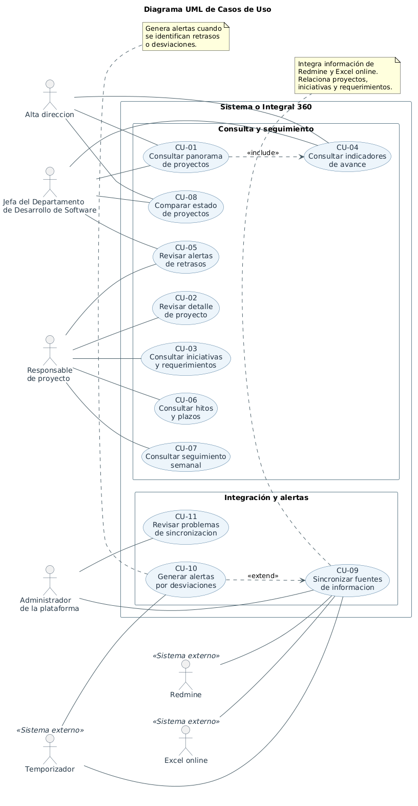

# UNIVERSIDAD TÉCNICA PARTICULAR DE LOJA

**Carrera de Ingeniería en Ciencias de la Computación · Séptimo ciclo**

**ARQUITECTURA DE SOFTWARE**

**VISIÓN INTEGRAL 360**

**Propuesta de solución · DAS, sección inicial**

**Grupo B · Taller 2**

**Institución beneficiaria:** COAC Padre Julián Lorente

---

## 1. Integrantes y responsabilidades

| Integrante | Rol asignado | Correo institucional |
| :--- | :--- | :--- |
| Diana Bermeo | Arquitecta líder | drbermeo@utpl.edu.ec |
| Camilo Fierro | Modelador | cjfierro1@utpl.edu.ec |
| Steven Vega | Revisor | srvega4@utpl.edu.ec |
| Lady Robalino | Documentadora y bitácora de IA | lyrobalino1@utpl.edu.ec |

**Docente:** Ing. Jackson Masache  
**Fecha de elaboración:** 20 de octubre de 2026  
**Período académico:** Octubre 2026 – Febrero 2027  
**Estado del documento:** propuesta académica inicial. Los datos sobre la operación institucional proceden del TDR y del relato del equipo acerca de una reunión; los aspectos técnicos no confirmados se registran como supuestos.

---

## 2. Contexto del problema

La Cooperativa de Ahorro y Crédito Padre Julián Lorente requiere disponer de una visión integrada de sus proyectos. El TDR identifica dispersión de información y seguimiento manual entre herramientas y archivos, con el consiguiente riesgo de inconsistencias y retrasos en los reportes.

Según lo comprendido por el Grupo B durante la reunión con la jefa del Departamento de Desarrollo de Software, la institución utiliza Redmine para gestionar información vinculada con proyectos, iniciativas y requerimientos. También mantiene un Excel online compartido, actualizado semanalmente con aportes de reuniones. El equipo entiende que Redmine incorpora información procedente de GitLab y SonarQube, pero el mecanismo exacto de intercambio aún no ha sido verificado.

La propuesta surge de la dificultad de relacionar y consultar de forma conjunta lo almacenado en Redmine y lo registrado en Excel. Ambas fuentes comparten tres conceptos: proyectos, iniciativas y requerimientos; sin embargo, queda por comprobar si sus valores constituyen claves comunes confiables. El reto arquitectónico es consolidar esas fuentes sin duplicar registros, conservar la trazabilidad del origen y presentar información clara para el seguimiento y la toma de decisiones.

**Desafíos identificados:** integración de fuentes heterogéneas; correspondencia entre registros; calidad y vigencia de datos; permisos de acceso; definición compartida de indicadores.

---

## 3. Objetivos

### 3.1. Objetivo general

Diseñar la arquitectura de software de Visión Integral 360, una aplicación web que consulte y consolide información de Redmine y del Excel online compartido para facilitar el seguimiento de proyectos, iniciativas y requerimientos de la cooperativa, mediante indicadores, alertas y vistas diferenciadas por perfil.

### 3.2. Objetivos específicos

* Identificar y documentar a los interesados, sus roles, preocupaciones y restricciones, de acuerdo con ISO/IEC/IEEE 42010.
* Definir mecanismos de obtención, normalización y correspondencia entre los datos de Redmine y del Excel compartido.
* Describir la solución mediante las vistas del modelo 4+1, manteniendo trazabilidad entre requisitos, escenarios y componentes.
* Priorizar atributos de calidad verificables, especialmente interoperabilidad, seguridad y fiabilidad, y justificar las decisiones arquitectónicas.
* Construir un prototipo mínimo que integre al menos dos fuentes reales autorizadas o simuladas, muestre información consolidada y evidencie KPI y alertas.

---

## 4. Interesados y preocupaciones (ISO/IEC/IEEE 42010)

Se distinguen los stakeholders exigidos por el TDR, la interlocutora identificada en la reunión y otros roles institucionales propuestos. Cada uno se asocia con una preocupación y una respuesta arquitectónica inicial. «Por validar» indica que el rol formal todavía no ha sido confirmado por la cooperativa.

| Interesado / evidencia | Rol respecto de la solución | Preocupación principal | Cómo la atendería la arquitectura |
| :--- | :--- | :--- | :--- |
| Jefa de Desarrollo de Software · Reunión | Interlocutora y referente funcional inicial | Disponer de una visión unificada del seguimiento y evitar reportes fragmentados. | Integración de Redmine y Excel; tablero consolidado con procedencia de datos. |
| Alta dirección · TDR | Usuario estratégico | Estado general, hitos, riesgos y apoyo a decisiones. | Vista ejecutiva con KPI consolidados y alertas. |
| Responsables de proyectos · TDR | Usuario de seguimiento | Avances, iniciativas, requerimientos, responsables y retrasos. | Vista por proyecto, filtros y trazabilidad de información. |
| Área de proyectos / coordinación · Por validar | Gestor funcional de proyectos | Definir reglas de avance, prioridades y significados de indicadores. | Modelo de datos común y reglas de KPI explícitas y documentadas. |
| Participantes de reuniones · Inferido | Proveedores de información | Asegurar que los aportes semanales aparezcan correctamente. | Conector de Excel, validaciones y fecha de actualización. |
| Responsable del Excel · Por validar | Custodio de fuente de datos | Integridad, permisos y cambios de estructura del archivo. | Adaptador de fuente con validación de esquema y registro de errores. |
| Administrador de Redmine · Por validar | Custodio técnico de fuente | Consulta autorizada, disponibilidad de API y uso de campos. | Conector de solo lectura, gestión segura de credenciales y sincronización. |
| Desarrolladores / equipo de TI · Por validar | Usuario técnico y mantenedor | Compatibilidad, trazabilidad y capacidad de evolución. | Módulos independientes, interfaces definidas y bitácoras de errores. |
| Responsable de seguridad · Por validar | Validador de controles | Confidencialidad, permisos y protección de credenciales. | Autenticación, autorización por roles y comunicación segura. |
| Docente y equipo académico · TDR | Evaluador / autores del DAS | Coherencia del modelo, notación y justificación del diseño. | Vistas 4+1, ADR, repositorio Git y evidencia de validación. |

Los cargos y permisos institucionales no se atribuyen a personas concretas sin confirmación. La aprobación formal de los requisitos y los accesos a fuentes siguen pendientes.

---

## 5. Alcance de la solución

### 5.1. Dentro del prototipo

* Consulta de dos fuentes identificadas: Redmine y el Excel online compartido; se utilizarán copias simuladas si no existe autorización de datos reales.
* Normalización de datos y asociación controlada entre proyectos, iniciativas y requerimientos.
* Visualización de estado, avances, hitos y responsables cuando la información de origen lo permita.
* Cálculo automático de un conjunto inicial de KPI acordado con los usuarios o, para la prueba, definido con datos simulados.
* Alertas sobre atrasos o datos inconsistentes, según reglas explícitas; vistas diferenciadas para responsables de proyectos y alta dirección.

### 5.2. Fuera de alcance

* Reemplazar o administrar íntegramente Redmine o el Excel compartido; alterar registros originales mediante la aplicación.
* Construir integraciones directas nuevas con GitLab y SonarQube; su conexión con Redmine es contexto informado y todavía debe verificarse.
* Implementar una plataforma terminada para producción o usar datos institucionales reales sin autorización.
* Entrenar modelos predictivos de inteligencia artificial o automatizar decisiones de gerencia.

---

### 5.3. Fuentes de datos

| Fuente | Papel en el proyecto | Mecanismo previsto / condición |
| :--- | :--- | :--- |
| Redmine | Fuente operativa de proyectos, iniciativas y requerimientos. | Evaluar API REST y permisos de lectura; campos disponibles por verificar. |
| Excel online compartido | Información complementaria registrada semanalmente en reuniones. | Acceso autorizado al archivo o exportación CSV/XLSX; proveedor y API no confirmados. |
| GitLab y SonarQube | Sistemas del entorno existente, relacionados con Redmine según reunión. | No se conectarán directamente en el prototipo inicial; relación técnica pendiente de confirmar. |

---

## 6. Requisitos iniciales

### 6.1. Requisitos funcionales

| Código | Requisito inicial |
| :--- | :--- |
| RF-01 | Consultar registros de proyectos, iniciativas y requerimientos desde Redmine. |
| RF-02 | Obtener los datos complementarios del Excel online compartido. |
| RF-03 | Normalizar campos y relacionar registros comunes mediante reglas verificables, registrando los casos ambiguos. |
| RF-04 | Mostrar la vista consolidada de cada proyecto, sus hitos, avances y responsables cuando existan datos suficientes. |
| RF-05 | Calcular KPI automáticamente a partir de fórmulas y definiciones documentadas. |
| RF-06 | Señalar retrasos, riesgos o desviaciones mediante reglas de alerta inicialmente configurables. |
| RF-07 | Ofrecer vistas y consultas adecuadas a los perfiles de responsable de proyecto y alta dirección. |
| RF-08 | Mostrar el origen y la última fecha de actualización de los datos consultados. |

### 6.2. Requisitos no funcionales preliminares

| Código / atributo | Requisito inicial y criterio de evaluación propuesto |
| :--- | :--- |
| RNF-01 · Interoperabilidad | Procesar información de ambas fuentes a un modelo común; en la prueba, no producir asociaciones falsas con registros de correspondencia conocida. |
| RNF-02 · Seguridad | Rechazar todas las consultas de prueba realizadas sin autorización y evitar exponer credenciales de Redmine o Excel. |
| RNF-03 · Fiabilidad | Ante falla simulada de una fuente, conservar los datos previamente consolidados e informar el estado de sincronización. |
| RNF-04 · Rendimiento | Responder en hasta 3 s en consultas de prueba de un conjunto reducido; cifra sujeta a validación con usuarios. |
| RNF-05 · Escalabilidad / modificabilidad | Incorporar un conector de fuente adicional sin alterar los casos de uso de consulta existentes, en una prueba de extensibilidad. |
| RNF-06 · Usabilidad | Permitir encontrar el estado y el responsable de un proyecto en una ruta sencilla de consulta; verificar mediante prueba con usuarios. |

Estas metas son hipótesis del equipo, no compromisos pactados con la cooperativa. Los tres atributos priorizados para el diseño inicial son interoperabilidad, seguridad y fiabilidad.

---

## 7. Supuestos, restricciones y respuestas a preguntas guía

### 7.1. Supuestos por validar

| ID | Supuesto / pendiente de confirmación |
| :--- | :--- |
| SUP-01 | Se habilitará un mecanismo autorizado para consultar Redmine (API o exportación). |
| SUP-02 | El Excel online podrá leerse por API, exportación o archivo de prueba; proveedor aún no identificado. |
| SUP-03 | Los conceptos proyecto, iniciativa y requerimiento dispondrán de claves o reglas de correspondencia suficientemente consistentes. |
| SUP-04 | La relación Redmine–GitLab–SonarQube se encuentra disponible en los datos expuestos por Redmine, según lo relatado, pero sin verificación de campos ni flujos. |
| SUP-05 | Existen datos necesarios para definir al menos un KPI de avance y una alerta; sus fórmulas requieren aprobación funcional. |
| SUP-06 | La actualización del Excel es semanal; la frecuencia objetivo del dashboard y Redmine deberá acordarse. |
| SUP-07 | La alta dirección y los responsables de proyecto tendrán perfiles de consulta diferenciados; permisos exactos por definir. |

### 7.2. Restricciones

* El sistema debe respetar las autorizaciones para acceder a información de la cooperativa.
* El prototipo no estará destinado a producción y puede emplear fuentes simuladas.
* El desarrollo deberá ajustarse a las semanas y entregables académicos definidos por el TDR.
* La tecnología concreta no queda elegida definitivamente en esta fase; deberá justificarse frente a los atributos de calidad.

### 7.3. Respuestas iniciales a las preguntas guía del Anexo B

| Pregunta del TDR | Respuesta inicial del Grupo B |
| :--- | :--- |
| ¿Qué fuentes usan y cuáles exponen API? | Redmine y Excel online compartido. Redmine dispone de API REST como capacidad del producto, pero el acceso institucional y el mecanismo para Excel deben verificarse. |
| ¿Cómo definir avance y desviación? | Se propone definir avance con hitos o actividades ponderadas y desviación como diferencia entre progreso real y planificado; aún no se conoce la fórmula institucional. |
| ¿Qué canal de alertas? | Como primera opción, alertas visibles en el dashboard. Correo u otros canales se evaluarán después de consultar a usuarios y TI. |
| ¿Qué significa «inteligente»? | Para el prototipo: reglas de negocio que detecten retrasos, datos inconsistentes o desviaciones. Predicción mediante IA se deja como futura evolución. |

---

## 8. Visión inicial de la solución

Se propone una página web independiente que consulte Redmine y el Excel compartido a través de conectores de lectura, transforme los registros a un esquema común y exponga indicadores y alertas en un dashboard para dos perfiles de consulta. Las conexiones desde GitLab y SonarQube hacia Redmine se muestran como información reportada que requiere validación técnica.

*Figura 1. Diagrama conceptual de contexto y flujo de información del Reto “Visión Integral 360”.*

### 8.1. Tecnologías candidatas (no aprobadas)

| Capa / componente | Alternativas a estudiar | Criterio para decidir |
| :--- | :--- | :--- |
| Frontend web | React o Vue; HTML/CSS/JavaScript | Usabilidad, capacidad del equipo y facilidad de mantenimiento. |
| Servicios de aplicación | Python con FastAPI o Node.js con Express | Integración, pruebas y separación modular. |
| Persistencia | PostgreSQL o SQLite para prototipo | Consistencia y sencillez de despliegue. |
| Acceso a fuentes | API REST de Redmine; API del proveedor de Excel o importación CSV/XLSX | Disponibilidad, permisos y restricciones institucionales. |
| Diagramado / CI/CD | PlantUML o Mermaid; GitLab CI/CD o alternativa del repositorio | Reproducibilidad de diagramas y automatización básica. |

Este boceto no equivale a seleccionar microservicios, SOA o arquitectura en capas: tales opciones se compararán en las semanas señaladas en el TDR.

---

## 9. Plan de trabajo y responsables (semanas 3–16)

El cronograma sigue las semanas del TDR. La responsabilidad primaria se asigna según los roles académicos, pero todo el grupo participa en las revisiones y defensas del diseño.

| Semana / fechas | Entregable según TDR | Responsable principal |
| :--- | :--- | :--- |
| 3 · 19–25 oct 2026 | Casos de uso y especificaciones. | Camilo (modelado); Diana (validación). |
| 4 · 26 oct–1 nov | Diagrama y diccionario de clases; vista lógica. | Camilo; revisión de Steven. |
| 5 · 2–8 nov | Objetos E–B–C y diagramas de secuencia. | Camilo; Diana. |
| 6 · 9–15 nov | Dominios, componentes y paquetes; vista desarrollo. | Diana y Camilo. |
| 7 · 16–22 nov | Diagrama de despliegue. | Camilo; revisión de Steven. |
| 8 · 23–29 nov | Entrega DAS v1, exposición e informe de prácticas. | Lady (integración); Steven (revisión); todos (exposición). |
| 9 · 30 nov–6 dic | Escenarios de atributos de calidad. | Diana; Steven (verificación). |
| 10 · 7–13 dic | Análisis de estilo cliente-servidor. | Diana; Camilo. |
| 11 · 14–20 dic | Análisis de arquitectura en capas. | Diana; Camilo. |
| 12 · 21 dic–3 ene 2027 | Análisis de 3 / N capas. | Diana; Steven. |
| 13 · 4–10 ene | Análisis SOA. | Diana; Steven. |
| 14 · 11–17 ene | Microservicios, decisión arquitectónica (ADR), pipeline CI/CD. | Diana (ADR); equipo (pipeline). |
| 15 · 18–24 ene | Prototipo con puertos y adaptadores. | Equipo; Diana (coherencia técnica). |
| 16 · 25–31 ene | DAS v2, prototipo y exposición final. | Lady (DAS); Steven (calidad); todos (exposición). |

**Tareas transversales:** Lady mantiene la documentación y la bitácora de IA; Steven revisa la trazabilidad antes de cada entrega; Diana asegura consistencia técnica y alternativas de decisión.

---

## 10. Anexos

### Anexo 1. Repositorio Git

* **Enlace del repositorio:** [https://github.com/Steven2610/ArquitecturaDeSoftware.git](https://github.com/Steven2610/ArquitecturaDeSoftware.git)

Se sugiere organizar el repositorio con carpetas para `/docs`, `/diagramas`, `/adr`, `/prototipo` y `/bitacora-ia`. El nombre y la plataforma del repositorio se completarán cuando el equipo lo haya creado.

### Anexo 2. Bitácora inicial de uso de IA

El TDR exige registrar fecha, modelo, objetivo, prompt, resumen de respuesta y decisión del equipo (aceptado, corregido o descartado, con justificación). La documentadora es responsable del registro. Se ofrece una entrada provisional para validar contra el historial real del chat antes de subirla.

| Campo | Registro inicial  |
| :--- | :--- |
| Fecha | 20 de octubre de 2026 |
| Modelo | ChatGPT – GPT-6 |
| Objetivo | Estructurar la propuesta de solución  |
| Prompt utilizado | Necesito que actúes como ingeniero en ciencias de la computación y me ayudes a resolver un problema referente a un Dashboard gerencial, por lo que entendimos junto a mi equipo de la reunión que se nos brindó por parte de la cooperativa la cual es la que nos pide una solución para ese reto, se utiliza readmine que se encarga de recoger los datos del git lab y de sonarqube; en un excel tienen información adicional que realizan en las reuniones pero que tienen tres campos en común con el redmine que son proyectos iniciativas y requerimientos . la idea es crear una página que consuma la información del redmine y del Excel online compartido que aportan cada semana para organizarlo todo en la plataforma. ese el contexto actual, la que nos dio el contesto fue la jefa del departamento de desarrollo de software de la padre Julián, ayúdame a identificar otros stakeholders. |
| Resumen de respuesta | Se elaboró una propuesta Word con stakeholders y roles, alcance, fuentes, RF/RNF, supuestos, visión y plan semanal. |
| Decisión del equipo | Aceptado con correcciones |

### Anexo 3. Fuentes y evidencias del proyecto

* TDR del curso Arquitectura de Software, versión del 14 de octubre de 2026; especialmente Anexo B (Grupo B).
* Formato docente «Lo que debería tener la propuesta de solución que entrega cada equipo» (imagen facilitada por el equipo).
* Información expuesta durante reunión con la jefa del Departamento de Desarrollo de Software, según relato del equipo; requiere validación posterior.

---

## Anexo complementario A. Escenarios de calidad (6 partes)

Se anexan tres escenarios preliminares correspondientes a los atributos de calidad priorizados. Estos escenarios aportan trazabilidad para el diseño, pero los valores propuestos deben confirmarse y ensayarse durante la validación del prototipo.

### A.1. EC-01 · Interoperabilidad de registros

| Parte | Descripción |
| :--- | :--- |
| Fuente del estímulo | Redmine y Excel online compartido. |
| Estímulo | Se reciben proyectos, iniciativas y requerimientos con campos heterogéneos y posibles coincidencias ambiguas. |
| Entorno | Sincronización de prueba con datos simulados o autorizados. |
| Artefacto | Conectores, normalizador y motor de correspondencia. |
| Respuesta | Relacionar solo coincidencias confiables; registrar entradas no asociadas o ambiguas. |
| Medida de respuesta | En 100 registros de prueba con resultados conocidos, vincular el 100 % de coincidencias inequívocas y registrar cero asociaciones falsas. |

### A.2. EC-02 · Seguridad de consultas

| Parte | Descripción |
| :--- | :--- |
| Fuente del estímulo | Usuario autenticado sin permiso de lectura para un conjunto de proyectos. |
| Estímulo | Solicita datos restringidos desde el dashboard o la API. |
| Entorno | Operación normal con control de acceso activo. |
| Artefacto | Servicio de autorización y API del dashboard. |
| Respuesta | Denegar solicitudes sin permiso y no revelar datos ni credenciales. |
| Medida de respuesta | Rechazar el 100 % de 20 consultas no autorizadas simuladas, sin filtración de datos. |

### A.3. EC-03 · Fiabilidad ante caída de fuente

| Parte | Descripción |
| :--- | :--- |
| Fuente del estímulo | Servicio de Redmine o servicio de acceso al Excel. |
| Estímulo | Un servicio no responde durante un intento de sincronización. |
| Entorno | Plataforma con datos consolidados previamente. |
| Artefacto | Sincronizador, repositorio de información y dashboard. |
| Respuesta | Conservar los datos válidos anteriores y mostrar la fecha de última actualización y el fallo. |
| Medida de respuesta | En 10 pruebas con interrupción, mantener disponibles los registros previos en las 10 y mostrar estado de error. |

# DAS – Sección 2: Casos de uso – Visión Integral 360

**Entrega:** Semana 3, 26 de octubre de 2026  
**Origen:** continuidad de la propuesta de solución del Taller 2; requerimientos RF-01 a RF-08, stakeholders y objetivos específicos conservados.

> **Nota de alcance:** según la entrevista, se utilizan Redmine y un Excel online compartido. GitLab y SonarQube se describen como contexto de Redmine, pero no como fuentes directas de este prototipo. Para la práctica del curso, Redmine y Excel se representan con datos y servicios simulados. Los indicadores y reglas pendientes se tratarán como supuestos, no como definiciones oficiales de la cooperativa.

## Contexto y relación con la primera versión

La primera versión del proyecto ya establece como fuentes **Redmine** y el **Excel**. Ambas manejan los conceptos de **proyectos, iniciativas y requerimientos**, pero todavía no sabemos si usan identificadores equivalentes. El reto consiste en consolidar información de ambas fuentes para mostrar avances, indicadores y alertas, evitando relaciones incorrectas.

Esta sección se apoya en los siguientes requisitos existentes: RF-01 y RF-02 (consultar fuentes), RF-03 (correspondencia), RF-04 (estado de proyectos), RF-05 (KPI), RF-06 (alertas), RF-07 (vistas por perfil) y RF-08 (origen y fecha de actualización).

## 1. Actores

| Actor | Tipo | Objetivo principal | Estado |
| --- | --- | --- | --- |
| Jefa del Departamento de Desarrollo de Software | Persona | Consultar la situación global de los proyectos, indicadores y alertas. | Identificada durante la entrevista. |
| Alta dirección | Persona | Conocer avances y riesgos para tomar decisiones. | Actor previsto en el TDR. |
| Responsable de proyecto | Persona | Revisar proyectos, iniciativas, requerimientos, hitos y alertas. | Actor previsto en el TDR. |
| Administrador de la plataforma | Persona | Solicitar sincronizaciones y revisar problemas de integración. | Rol propuesto; pendiente de validación. |
| Temporizador externo  | Sistema externo | Iniciar la sincronización programada y la evaluación automática de alertas. | Candidato técnico ; no es un usuario humano. |
| Redmine  | Sistema externo | Suministrar registros de proyectos, iniciativas y requerimientos. | Sistema real identificado; acceso  en el trabajo. |
| Excel online  | Sistema externo | Suministrar información complementaria registrada semanalmente. | Fuente real descrita en la entrevista; acceso. |

## 2. Catálogo priorizado

| ID | Caso de uso | Actor principal | Prioridad | Justificación |
| --- | --- | --- | --- | --- |
| CU-01 | Consultar panorama de proyectos | Jefa de Desarrollo / Alta dirección | Alta | Ofrece una visión general para la toma de decisiones. |
| CU-02 | Revisar detalle de proyecto | Responsable de proyecto | Alta | Permite conocer avances y responsables de un proyecto específico. |
| CU-03 | Consultar iniciativas y requerimientos | Responsable de proyecto | Alta | Relaciona los tres conceptos comunes a Redmine y Excel. |
| CU-04 | Consultar indicadores de avance | Jefa de Desarrollo / Alta dirección | Alta | Resume información mediante indicadores automáticos. |
| CU-05 | Revisar alertas de retrasos | Responsable de proyecto / Jefa de Desarrollo | Alta | Permite conocer situaciones que necesitan atención. |
| CU-06 | Consultar hitos y plazos | Responsable de proyecto | Media | Permite revisar compromisos y fechas previstas. |
| CU-07 | Consultar seguimiento semanal | Responsable de proyecto | Media | Aprovecha datos adicionales de las reuniones registrados en Excel. |
| CU-08 | Comparar estado de proyectos | Jefa de Desarrollo / Alta dirección | Media | Facilita comparar diferentes proyectos en un mismo período. |
| CU-09 | Sincronizar fuentes de información | Temporizador externo / Administrador | Alta | Integra la información de Redmine y Excel. |
| CU-10 | Generar alertas por desviaciones | Temporizador externo | Alta | Detecta automáticamente posibles retrasos o incumplimientos. |
| CU-11 | Revisar problemas de sincronización | Administrador de plataforma | Media | Permite identificar fuentes sin actualizar o registros rechazados. |

## 3. Diagrama UML

**Archivo fuente:** [Ver código PlantUML](../diagramas/vision360-casos-de-uso.puml)

- CU-01 «include» CU-04: consultar un panorama siempre incluye sus indicadores de avance.
- CU-09 «include» CU-10: **decisión preliminar del equipo**: toda sincronización completada con datos válidos desencadena la evaluación de reglas de alerta; evaluar las reglas no significa que siempre se genere una alerta. Cuando ambas fuentes fallan, el flujo excepcional termina sin invocar CU-10.

## 4. Especificaciones de casos de uso

Se seleccionan **CU-01, CU-09 y CU-10** porque son tres de los casos de mayor prioridad del catálogo y cubren funciones centrales de Visión Integral 360: consultar el panorama de proyectos, consolidar información de Redmine y Excel online, y generar alertas por desviaciones.

Las especificaciones se relacionan con los actores, el diagrama UML y los requisitos funcionales RF-01 a RF-08 definidos anteriormente.

### CU-01 – Consultar panorama de proyectos

| Campo | Descripción |
|---|---|
| **ID** | CU-01 |
| **Actor principal** | Jefa del Departamento de Desarrollo de Software / Alta dirección |
| **Otros actores** | Ninguno |
| **Objetivo** | Consultar una vista general de los proyectos para conocer sus estados, indicadores, alertas y fechas de actualización. |
| **Relación UML** | Incluye CU-04 – Consultar indicadores de avance. |
| **Requisitos relacionados** | RF-04, RF-05, RF-07 y RF-08 |

#### Precondiciones

1. El usuario tiene una sesión activa en Visión Integral 360.
2. El usuario cuenta con permisos para consultar el panorama de proyectos.
3. El sistema dispone de información consolidada o tiene registrado que todavía no existen datos disponibles.

#### Postcondiciones

**Si termina bien:**

- Se presenta la información general de los proyectos que el usuario tiene autorización para consultar.
- Se muestran los indicadores disponibles y la fecha de última actualización.
- Los datos consultados permanecen sin modificaciones.

**Si falla:**

- El sistema informa que no fue posible completar la consulta.
- No se muestra información restringida ni se alteran los registros existentes.

#### Flujo principal

| Paso | Acción |
|---|---|
| 1 | **Usuario:** Solicita consultar el panorama general de proyectos. |
| 2 | **Sistema:** Verifica los permisos y presenta los períodos disponibles para consulta. |
| 3 | **Usuario:** Selecciona el período de seguimiento que desea revisar. |
| 4 | **Sistema:** Recupera los proyectos correspondientes al período seleccionado y presenta su estado general. |
| 5 | **Usuario:** Solicita revisar el resumen de indicadores del período seleccionado. |
| 6 | **Sistema:** Ejecuta CU-04 para presentar los indicadores de avance y muestra las alertas disponibles y la fecha de última actualización. |
| 7 | **Usuario:** Selecciona un criterio para filtrar los proyectos, como estado o responsable. |
| 8 | **Sistema:** Actualiza el panorama y presenta los proyectos correspondientes al filtro seleccionado. |

#### Flujos alternativos

- **FA-01 (Paso 4).** No existen proyectos correspondientes al período seleccionado. El sistema informa que no se encontraron resultados y permite regresar al paso 3 para elegir otro período.

- **FA-02 (Paso 6).** La información de alguna fuente no se encuentra actualizada. El sistema presenta los indicadores disponibles e informa la fecha real de última actualización. La consulta continúa en el paso 7.

- **FA-03 (Paso 8).** No existen proyectos que coincidan con el filtro seleccionado. El sistema informa que no hay resultados y permite regresar al paso 7 para seleccionar otro criterio.

#### Excepciones

**E-01 (Paso 4).** El sistema no puede recuperar la información consolidada de los proyectos debido a una falla del servicio. Informa al usuario que no es posible completar la consulta y termina el caso de uso.

#### Requisitos especiales

1. **Rendimiento:** En una prueba con 100 proyectos y 10 consultas concurrentes, al menos el 95 % de las consultas deberá responder en menos de 3 segundos.
2. **Seguridad:** El sistema deberá mostrar únicamente los proyectos autorizados para el perfil del usuario.
3. **Trazabilidad:** Se deberá identificar la fecha de última actualización de la información presentada.
4. **Usabilidad:** El usuario deberá poder identificar el estado general de un proyecto y sus indicadores principales mediante un máximo de tres acciones de navegación.

**Observación:** Si no existen datos suficientes para calcular un indicador, el sistema mostrará «No disponible» en lugar de presentar un valor sin sustento.

---

### CU-09 – Sincronizar fuentes de información

| Campo | Descripción |
|---|---|
| **ID** | CU-09 |
| **Actor principal** | Temporizador externo |
| **Actor iniciador alternativo** | Administrador de la plataforma |
| **Actores externos participantes** | Redmine y Excel online |
| **Objetivo** | Obtener y consolidar los registros de Redmine y Excel online, relacionando proyectos, iniciativas y requerimientos mediante reglas verificables. |
| **Relación UML** | Incluye CU-10 – Generar alertas por desviaciones, cuando la consolidación dispone de información válida. |
| **Requisitos relacionados** | RF-01, RF-02, RF-03 y RF-08 |

#### Precondiciones

1. El sistema cuenta con mecanismos de acceso configurados para Redmine y Excel online.
2. Existen reglas iniciales para validar y relacionar proyectos, iniciativas y requerimientos.
3. El servicio de sincronización está habilitado y no existe otra ejecución incompatible en curso.

#### Postcondiciones

**Si termina bien:**

- La información válida de Redmine y Excel online queda consolidada y disponible para consulta.
- Los registros conservan la referencia de su fuente de origen.
- Se registra la fecha, hora y resultado de la sincronización.
- Se ejecuta CU-10 para evaluar posibles alertas sobre la información consolidada.

**Si falla:**

- Se conserva la última versión válida de los datos.
- Se registra el problema y se identifica la fuente afectada.
- No se crean relaciones entre registros cuya correspondencia no pueda confirmarse.
- Si no se obtiene información de ninguna fuente, la sincronización termina sin iniciar una nueva evaluación de alertas.

#### Flujo principal

| Paso | Acción |
|---|---|
| 1 | **Temporizador:** Solicita iniciar la sincronización programada de información. |
| 2 | **Sistema:** Solicita a Redmine los registros disponibles de proyectos, iniciativas y requerimientos. |
| 3 | **Redmine:** Entrega la información solicitada. |
| 4 | **Sistema:** Solicita a Excel online los registros complementarios del seguimiento semanal. |
| 5 | **Excel online:** Entrega la información registrada en el archivo compartido. |
| 6 | **Sistema:** Valida los registros, relaciona la información confiable, guarda los resultados y registra la sincronización. Después ejecuta CU-10 para evaluar posibles desviaciones. |

#### Flujos alternativos

- **FA-01 (Paso 3).** Redmine no responde a la solicitud. El sistema registra el problema, conserva la última información válida de esa fuente y continúa en el paso 4 para consultar Excel online. Si esta segunda fuente responde, la actualización se registra como parcial y se procesan los datos disponibles.

- **FA-02 (Paso 5).** Excel online no responde a la solicitud. El sistema registra el problema, conserva la última información válida de Excel y continúa en el paso 6 con los datos recibidos de Redmine. La actualización se registra como parcial.

- **FA-03 (Paso 6).** Se identifican registros con coincidencias ambiguas entre Redmine y Excel online. El sistema no los relaciona automáticamente, registra la observación y continúa procesando los demás registros válidos.

- **FA-04 (Paso 1).** El administrador de la plataforma solicita una sincronización manual. El sistema comprueba que tenga autorización y continúa desde el paso 2.

#### Excepciones

**E-01 (Paso 5).** Redmine no respondió a la solicitud anterior y Excel online tampoco se encuentra disponible. El sistema registra el fallo de ambas fuentes, conserva la última información válida y termina la sincronización sin actualizar los registros ni iniciar CU-10.

#### Requisitos especiales

1. **Interoperabilidad:** En una prueba con 200 registros, el sistema deberá procesar la información válida en menos de 5 minutos.
2. **Integridad:** En un conjunto de prueba con correspondencias conocidas, no deberá generar asociaciones falsas entre proyectos, iniciativas y requerimientos.
3. **Fiabilidad:** Cada sincronización deberá quedar registrada con fecha, hora, resultado y fuentes afectadas, indicando si fue exitosa, parcial o fallida.
4. **Seguridad:** El acceso a Redmine y Excel online deberá realizarse mediante mecanismos autorizados y sin exponer credenciales.

**Observación:** Las fuentes principales del proyecto son Redmine y Excel online. GitLab y SonarQube forman parte del contexto descrito en la entrevista, pero no se incorporan como fuentes directas en esta etapa.

---

### CU-10 – Generar alertas por desviaciones

| Campo | Descripción |
|---|---|
| **ID** | CU-10 |
| **Actor principal** | Temporizador externo |
| **Inicio adicional** | Ejecución del CU-10 desde CU-09 después de consolidar información válida |
| **Otros actores** | Ninguno |
| **Objetivo** | Evaluar la información de proyectos e hitos para identificar retrasos o desviaciones y registrar las alertas correspondientes. |
| **Relación UML** | Caso incluido por CU-09 y ejecutable también mediante programación automática. |
| **Requisitos relacionados** | RF-05, RF-06 y RF-08 |

#### Precondiciones

1. El sistema dispone de información consolidada válida sobre al menos un proyecto.
2. Se encuentran definidas las reglas iniciales para identificar retrasos y desviaciones.
3. El proceso de evaluación de alertas se encuentra habilitado.

#### Postcondiciones

**Si termina bien:**

- Las condiciones que cumplen las reglas establecidas quedan registradas como alertas consultables.
- Se registra la fecha y hora de la evaluación.
- No se crean alertas duplicadas para un mismo proyecto y una misma condición activa.
- Si no se identifican desviaciones, la evaluación finaliza correctamente sin generar alertas nuevas.

**Si falla:**

- No se generan alertas con información insuficiente o no verificable.
- Se registra la causa por la cual no pudo completarse la evaluación.
- Las alertas válidas registradas anteriormente se conservan.

#### Flujo principal

| Paso | Acción |
|---|---|
| 1 | **Temporizador:** Solicita iniciar la evaluación programada de posibles desviaciones. |
| 2 | **Sistema:** Recupera los proyectos e hitos de la última información consolidada válida. |
| 3 | **Sistema:** Verifica que los registros contengan fechas, estados y datos suficientes para su evaluación. |
| 4 | **Sistema:** Aplica las reglas definidas para identificar retrasos o desviaciones. |
| 5 | **Sistema:** Identifica las condiciones de alerta y comprueba si ya existen alertas activas para esos proyectos. |
| 6 | **Sistema:** Registra las alertas nuevas sin duplicar las existentes, guarda el resultado de la evaluación y deja la información disponible para consulta. |

#### Flujos alternativos

- **FA-01 (Paso 1).** La evaluación se inicia como parte de CU-09 después de consolidar información válida. El sistema comienza directamente desde el paso 2, utilizando la información actualizada.

- **FA-02 (Paso 3).** Un proyecto no tiene datos suficientes para identificar una desviación. El sistema registra que ese proyecto no puede evaluarse y continúa con los demás registros en el paso 4.

- **FA-03 (Paso 5).** Ningún proyecto presenta condiciones que requieran una alerta. El sistema registra que la evaluación se completó sin encontrar nuevas desviaciones y continúa en el paso 6.

- **FA-04 (Paso 5).** Una condición detectada ya tiene una alerta activa. El sistema conserva esa alerta, evita generar otra igual y continúa en el paso 6.

#### Excepciones

**E-01 (Paso 2).** El sistema no puede recuperar la información consolidada necesaria para evaluar los proyectos. Registra el problema y termina el proceso sin generar nuevas alertas.

#### Requisitos especiales

1. **Rendimiento:** En una prueba con 100 proyectos, el sistema deberá completar la evaluación en menos de 60 segundos.
2. **Exactitud:** En un conjunto de 20 situaciones previamente clasificadas, deberá identificar correctamente las 20 condiciones de acuerdo con las reglas establecidas.
3. **Fiabilidad:** No deberán existir dos alertas activas para el mismo proyecto y la misma condición.
4. **Trazabilidad:** Cada alerta deberá indicar el proyecto relacionado, la condición detectada y la fecha de generación.

**Observación:** Las fórmulas de avance, los umbrales de retraso y las condiciones exactas para generar alertas todavía deben validarse con los responsables de la cooperativa.

---

