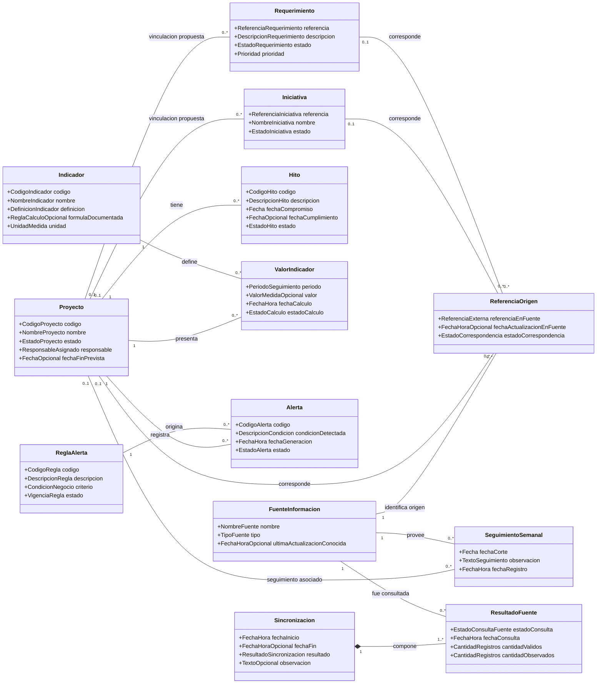

## 3.1. Escenarios de dominio y extracción de sustantivos
### E-01 – CU-01 · Consultar panorama de proyectos

El 30/10/2026, el rol de <u>Jefatura de Desarrollo de Software</u> **solicita** el <u>panorama de proyectos</u> del <u>período</u> octubre de 2026.

El <u>proyecto</u> ficticio P-001, «Canal web institucional», **aparece** en estado «En ejecución», con un <u>responsable</u> identificado y un <u>hito</u> H-01 previsto para el 28/10/2026.

El <u>indicador</u> «Avance del proyecto» tiene un <u>valor de indicador</u> de 60 % (dato de prueba, sin implicar una fórmula institucional aprobada). Se **muestra** la <u>fuente de información</u> Redmine y su <u>fecha de actualización</u>: 29/10/2026.

El rol directivo **consulta** el detalle y la fecha de corte; el sistema **conserva** los datos sin modificarlos.

**Trazabilidad:** CU-01, que **incluye** CU-04; RF-04, RF-05, RF-07 y RF-08; RNF-02, RNF-04 y RNF-06. Se consulta información autorizada sin alterarla.

### E-02 – CU-09 · Sincronizar fuentes y tratar coincidencias ambiguas

El 30/10/2026 a las 08:00, el <u>temporizador</u> (actor `<<tiempo>>`) **inicia** una <u>sincronización</u> de las <u>fuentes de información</u> Redmine y Excel online.

Redmine **entrega** el <u>proyecto</u> ficticio P-001, la <u>iniciativa</u> I-003 y el <u>requerimiento</u> R-015; Excel **entrega** un <u>seguimiento semanal</u> del 29/10/2026 relacionado con el mismo proyecto.

Una <u>referencia de origen</u> del Excel **coincide** con P-001 bajo una <u>regla de correspondencia</u> asumida únicamente para la prueba; otra referencia solo comparte un nombre parecido y resulta ambigua.

El sistema **conserva** el origen y la fecha de los registros válidos, no **relaciona** la referencia ambigua y **registra** la observación. El <u>resultado por fuente</u> **indica** que ambas respondieron; la <u>sincronización</u> termina como exitosa con observaciones. Al alcanzar el <u>punto de extensión</u> «información válida consolidada», CU-10 puede **extender** CU-09 si la evaluación está habilitada y la versión de los datos no se ha evaluado con las mismas reglas; no se ejecuta de forma incondicional.

**Trazabilidad:** CU-09; RF-01, RF-02, RF-03 y RF-08; RNF-01, RNF-03 y RNF-05; FA-03 (correspondencia ambigua) y FA-05 (estructura incompatible de Excel). Las claves y columnas reales siguen sin validarse.

### E-03 – CU-10 · Evaluar retrasos sin duplicar alertas

El 30/10/2026 a las 09:00 se **evalúa** el <u>proyecto</u> de prueba P-001, que **conserva** un <u>hito</u> H-01 con fecha de compromiso 28/10/2026 y estado «Pendiente».

Para esta prueba se utiliza una <u>regla de alerta</u> de ejemplo: «Si la fecha de compromiso ya pasó y el hito sigue pendiente, se identifica un retraso». No representa un umbral institucional aprobado.

La primera evaluación **registra** la <u>alerta</u> A-001 asociada a P-001 y a esa <u>regla de alerta</u>, con fecha y estado «Activa».

En una segunda evaluación de prueba, el sistema **encuentra** la misma condición activa y no crea otra <u>alerta</u>. Si se repite exactamente la versión de datos con las mismas reglas, **evita** evaluar de nuevo; si faltan datos verificables, tampoco crea alertas nuevas. CU-10 puede iniciarse por el actor <u>temporizador</u> o al cumplirse la extensión de CU-09.

**Trazabilidad:** CU-10; RF-06 y RF-08; RNF-03. El cálculo de KPI de RF-05 pertenece a CU-04; CU-10 usa información ya consolidada. Las alertas no se duplican por proyecto y condición activa.

### E-04 – CU-02 · Consultar seguimiento de un proyecto 

El 30/10/2026, el <u>responsable de proyecto</u> **selecciona** el <u>proyecto</u> ficticio P-001 y **consulta** su <u>seguimiento</u> autorizado. El sistema **presenta** el <u>estado de proyecto</u>, el <u>responsable asignado</u> y las <u>fechas de actualización</u> disponibles.

A continuación, el responsable **revisa** la <u>iniciativa</u> I-003 y el <u>requerimiento</u> R-015; después **consulta** el <u>hito</u> H-01 y el <u>seguimiento semanal</u> del 29/10/2026 procedente de <u>Excel online</u>. Cada registro **conserva** su <u>referencia de origen</u>; un elemento de correspondencia ambigua no se **vincula** automáticamente con P-001.

**Trazabilidad:** CU-02 vigente; RF-01, RF-02, RF-03, RF-04, RF-07 y RF-08. Los antiguos CU-03 (iniciativas/requerimientos), CU-06 (hitos/plazos) y CU-07 (seguimiento semanal) permanecen como variantes de consulta dentro de CU-02 y no son casos activos independientes. Los ejemplos son datos ficticios de prueba.

## 3.2. Cinco preguntas y lista de candidatos

**P1:** ¿Es un concepto relevante para el negocio?  
**P2:** ¿Tiene identidad o seguimiento independiente?  
**P3:** ¿Tiene atributos o reglas propios?  
**P4:** ¿Participa en relaciones del dominio?  
**P5:** ¿Es distinto de un actor, sistema externo, vista o componente técnico?

| Candidato (evidencia) | P1 | P2 | P3 | P4 | P5 | Decisión y justificación |
| --- | :---: | :---: | :---: | :---: | :---: | --- |
| Proyecto (E-01/E-02/TDR) | Sí | Sí | Sí | Sí | Sí | **Clase:** Identidad, estado, hitos e indicadores propios. |
| Iniciativa (E-02/DAS) | Sí | Sí | Sí | Sí | Sí | **Clase:** Concepto seguido en ambas fuentes. |
| Requerimiento (E-02/DAS) | Sí | Sí | Sí | Sí | Sí | **Clase:** Concepto seguido en ambas fuentes. |
| Hito (E-01/E-03/TDR) | Sí | Sí | Sí | Sí | Sí | **Clase:** Compromiso con fecha, estado y relaciones. |
| Seguimiento semanal (E-02/DAS) | Sí | Sí | Sí | Sí | Sí | **Clase:** Registro de reuniones con fecha y observación. |
| Indicador (E-01/TDR) | Sí | Sí | Sí | Sí | Sí | **Clase:** Definición de métrica con reglas propias. |
| Valor de indicador (E-01) | Sí | Sí | Sí | Sí | Sí | **Clase:** Medición con valor, período y fecha. |
| Regla de alerta (E-03/CU-10) | Sí | Sí | Sí | Sí | Sí | **Clase:** Condición reutilizable, no umbral definitivo. |
| Alerta (E-03/TDR) | Sí | Sí | Sí | Sí | Sí | **Clase:** Tiene identidad, estado y causa. |
| Fuente de información (E-01/E-02) | Sí | Sí | Sí | Sí | Sí | **Clase:** Concepto de procedencia; no conector técnico. |
| Referencia de origen (E-02/RF-08) | Sí | Sí | Sí | Sí | Sí | **Clase:** Relaciona registro, fuente y estado de correspondencia. |
| Sincronización (E-02/CU-09) | Sí | Sí | Sí | Sí | Sí | **Clase:** Ejecución registrada con estado y fecha. |
| Resultado por fuente (E-02/CU-09) | Sí | Sí | Sí | Sí | Sí | **Clase:** Datos propios de la relación fuente-ejecución. |
| Jefa de Desarrollo (E-01/CU-01) | Sí | Sí | Sí | Sí | No | **Actor:** Solicita consulta; no entidad de este modelo. |
| Temporizador externo (E-02/CU-09) | Sí | Sí | Sí | Sí | No | **Actor:** Inicia proceso automático. |
| Redmine (E-01/E-02) | Sí | Sí | Sí | Sí | No | **Sistema externo:** Fuente externa; distinta de FuenteInformacion. |
| Excel online (E-02) | Sí | Sí | Sí | Sí | No | **Sistema externo:** Fuente externa; distinta de FuenteInformacion. |
| Estado de proyecto (E-01) | Sí | No | No | Sí | Sí | **Atributo:** Dato descriptivo del Proyecto. |
| Fecha de compromiso (E-03) | Sí | No | No | Sí | Sí | **Atributo:** Dato propio del Hito. |
| Nombre del proyecto (E-01) | Sí | No | No | Sí | Sí | **Atributo:** Dato propio del Proyecto. |
| Fecha de actualización (E-01/E-02) | Sí | No | No | Sí | Sí | **Atributo:** Dato de ReferenciaOrigen o FuenteInformacion. |
| Período de consulta (E-01/CU-01) | Sí | No | No | Sí | Sí | **Criterio de consulta:** No forma una clase independiente ni un atributo persistente obligatorio. |
| Responsable asignado (E-01/RF-04) | Sí | No | No | Sí | Sí | **Atributo:** Persona de referencia del Proyecto; su interacción es la de un actor. |
| Responsable de proyecto (TDR/CU-02) | Sí | Sí | Sí | Sí | No | **Actor:** Rol humano ya identificado entre los actores. |
| Panorama de proyectos (E-01/CU-01) | No | No | No | No | No | **Descartar:** Es una vista de consulta, no entidad del dominio. |
| Regla de correspondencia (E-02/RF-03) | Sí | No | Sí | Sí | Sí | **Regla documentada, no clase por ahora:** La correspondencia se verifica mediante criterios, sin entidad autónoma confirmada. |
| Dashboard (TDR) | No | No | No | No | No | **Descartar:** Vista de presentación, no clase de dominio. |
| Controlador de sincronización (CU-09) | No | No | No | No | No | **Descartar:** Elemento de diseño/implementación fuera de la vista lógica. |
| Tabla de base de datos (-) | No | No | No | No | No | **Descartar:** Persistencia técnica, no concepto de negocio. |
| GitLab / SonarQube (Contexto DAS) | No | No | No | No | No | **Descartar:** No se incorporan como fuentes directas en esta etapa. |

## 3.3. Diagrama de clases del dominio

**Fuente versionable en Mermaid:** `diagramas/vision360-vista-logica.mmd`. 

**Restricciones que completan las multiplicidades:**

- `ReferenciaOrigen` se vincula con **cero o un** elemento entre `Proyecto`, `Iniciativa` y `Requerimiento`: si la correspondencia está confirmada, **exactamente uno**; si está pendiente o es ambigua, **ninguno**. No son tres relaciones simultáneas.

- Cada `ValorIndicador` pertenece a **un** proyecto y a **un** indicador; puede haber varias mediciones por período. No se presupone una fórmula ya aprobada.

- Cada `ResultadoFuente` pertenece a **una** sincronización y corresponde a **una** fuente; el conjunto de resultados de una sincronización permite identificar fallos parciales o totales.

- Una `Alerta` se asocia a un solo proyecto y una sola regla; el par proyecto-condición **no puede generar dos alertas activas**.

- Se permite provisionalmente que una `Iniciativa`, `Requerimiento` o `SeguimientoSemanal` no tenga un `Proyecto` confirmado (0..1), para no forzar la correspondencia de datos ambiguos; la jerarquía institucional **no ha sido validada**. Una `ReferenciaOrigen` confirmada debe vincularse con **exactamente uno** de los tres tipos `Proyecto`, `Iniciativa` o `Requerimiento`, nunca con varios a la vez; una referencia ambigua permanece sin asociación confirmada.

## 3.4. Diccionario de clases

### 3.4.1. Proyecto

**Descripción:** Unidad de seguimiento institucional cuyo avance, responsables, hitos y estado se consolidan.

| Atributo | Tipo de negocio | Descripción |
| --- | --- | --- |
| `codigo` | `CodigoProyecto` | Identificador de dominio usado dentro del modelo; equivalencia con claves de las fuentes por validar. |
| `nombre` | `NombreProyecto` | Denominación del proyecto. |
| `estado` | `EstadoProyecto` | Situación conocida del proyecto. |
| `responsable` | `ResponsableAsignado` | Referente de seguimiento; permisos y estructura organizativa por confirmar. |
| `fechaFinPrevista` | `FechaOpcional` | Fecha comprometida si se conoce; no se presume para todos los proyectos. |

**Reglas de negocio / restricciones:**

- Pueden existir varias referencias de origen para un mismo proyecto confirmado.

- El proyecto consultado debe respetar las autorizaciones del usuario (CU-01).

- No se presume que el código ilustrativo P-001 exista en la cooperativa.

### 3.4.2. Iniciativa

**Descripción:** Iniciativa registrada para seguimiento; su vinculación a un proyecto requiere correspondencia verificada.

| Atributo | Tipo de negocio | Descripción |
| --- | --- | --- |
| `referencia` | `ReferenciaIniciativa` | Identificación conceptual de la iniciativa. |
| `nombre` | `NombreIniciativa` | Denominación de la iniciativa. |
| `estado` | `EstadoIniciativa` | Situación reportada. |

**Reglas de negocio / restricciones:**

- Su asociación a un proyecto es opcional en este modelo (0..1), hasta validar la estructura real.

- Puede proceder de Redmine y/o Excel y tener referencias de origen.

### 3.4.3. Requerimiento

**Descripción:** Necesidad o solicitud registrada para seguimiento, con relación al proyecto solo cuando se confirma.

| Atributo | Tipo de negocio | Descripción |
| --- | --- | --- |
| `referencia` | `ReferenciaRequerimiento` | Identificador conceptual del requerimiento. |
| `descripcion` | `DescripcionRequerimiento` | Necesidad registrada. |
| `estado` | `EstadoRequerimiento` | Situación del requerimiento. |
| `prioridad` | `Prioridad` | Nivel de importancia, si lo proporciona la fuente. |

**Reglas de negocio / restricciones:**

- Se propone una asociación opcional (0..1) a proyecto; la relación exacta entre proyecto, iniciativa y requerimiento necesita validación.

- No relacionar requerimientos ambiguos por coincidencia de texto.

### 3.4.4. Hito

**Descripción:** Compromiso de seguimiento con fecha y estado, considerado al revisar atrasos.

| Atributo | Tipo de negocio | Descripción |
| --- | --- | --- |
| `codigo` | `CodigoHito` | Referencia del compromiso. |
| `descripcion` | `DescripcionHito` | Resultado o entrega comprometida. |
| `fechaCompromiso` | `Fecha` | Fecha prevista. |
| `fechaCumplimiento` | `FechaOpcional` | Fecha real de finalización, cuando exista. |
| `estado` | `EstadoHito` | Estado conocido del compromiso. |

**Reglas de negocio / restricciones:**

- Para detectar retrasos se debe disponer de una fecha y un estado verificables.

- La regla ilustrativa de vencimiento requiere validación institucional.

### 3.4.5. SeguimientoSemanal

**Descripción:** Registro complementario de seguimiento procedente del Excel online compartido, que puede quedar sin proyecto confirmado.

| Atributo | Tipo de negocio | Descripción |
| --- | --- | --- |
| `fechaCorte` | `Fecha` | Fecha de referencia del seguimiento. |
| `observacion` | `TextoSeguimiento` | Información relevante registrada en reuniones. |
| `fechaRegistro` | `FechaHora` | Momento registrado para ese seguimiento. |

**Reglas de negocio / restricciones:**

- Los aportes son semanales según el contexto del DAS; la frecuencia del dashboard no está aprobada.

- Debe identificarse la fuente y su fecha; no reemplazar sin control la última versión válida. Cuando la correspondencia con un proyecto sea ambigua, se registra el caso sin asociarlo automáticamente (CU-09, FA-03).

### 3.4.6. Indicador

**Descripción:** Definición de una medida de seguimiento de proyectos.

| Atributo | Tipo de negocio | Descripción |
| --- | --- | --- |
| `codigo` | `CodigoIndicador` | Referencia de la medida. |
| `nombre` | `NombreIndicador` | Ejemplo: avance del proyecto. |
| `definicion` | `DefinicionIndicador` | Significado de la medición. |
| `formulaDocumentada` | `ReglaCalculoOpcional` | Fórmula de negocio cuando esté documentada y validada; puede estar pendiente. |
| `unidad` | `UnidadMedida` | Ejemplo: porcentaje o cantidad. |

**Reglas de negocio / restricciones:**

- La fórmula debe ser documentada antes de su aplicación.

- Si no existe información suficiente, el indicador se presenta como «No disponible» (CU-01).

### 3.4.7. ValorIndicador

**Descripción:** Medición calculada de un indicador para un proyecto y período.

| Atributo | Tipo de negocio | Descripción |
| --- | --- | --- |
| `periodo` | `PeriodoSeguimiento` | Intervalo de la medición. |
| `valor` | `ValorMedidaOpcional` | Medición cuando existan datos verificables; ausente si no hay información suficiente. |
| `fechaCalculo` | `FechaHora` | Momento en el que se obtuvo. |
| `estadoCalculo` | `EstadoCalculo` | Calculado o no disponible. |

**Reglas de negocio / restricciones:**

- Una medición pertenece a un proyecto y a una definición de indicador.

- Un valor no disponible no se sustituye por una cifra inventada.

### 3.4.8. ReglaAlerta

**Descripción:** Condición de negocio definida para evaluar posibles retrasos o desviaciones.

| Atributo | Tipo de negocio | Descripción |
| --- | --- | --- |
| `codigo` | `CodigoRegla` | Referencia de la regla. |
| `descripcion` | `DescripcionRegla` | Qué situación busca identificar. |
| `criterio` | `CondicionNegocio` | Condición evaluable, pendiente de aprobación. |
| `estado` | `VigenciaRegla` | Vigente o no vigente. |

**Reglas de negocio / restricciones:**

- Los umbrales específicos requieren aprobación por la cooperativa.

- La evaluación de reglas puede terminar sin emitir una alerta (CU-10).

- La repetición de una misma versión consolidada con el mismo conjunto de reglas no debe provocar una evaluación duplicada; la forma de registrar esa evidencia se detallará en la vista de procesos.

### 3.4.9. Alerta

**Descripción:** Señal de una desviación verificada asociada a un proyecto y una regla.

| Atributo | Tipo de negocio | Descripción |
| --- | --- | --- |
| `codigo` | `CodigoAlerta` | Identificación de la alerta. |
| `condicionDetectada` | `DescripcionCondicion` | Motivo de la alerta. |
| `fechaGeneracion` | `FechaHora` | Momento de detección. |
| `estado` | `EstadoAlerta` | Situación activa o resuelta. |

**Reglas de negocio / restricciones:**

- No se permite más de una alerta activa para el mismo proyecto y la misma condición (CU-10).

- Si los datos son insuficientes no se genera una alerta nueva.

### 3.4.10. FuenteInformacion

**Descripción:** Referencia de negocio al origen de datos que contribuye a la consolidación.

| Atributo | Tipo de negocio | Descripción |
| --- | --- | --- |
| `nombre` | `NombreFuente` | Redmine o Excel online en el alcance actual. |
| `tipo` | `TipoFuente` | Categoría de origen, no mecanismo técnico. |
| `ultimaActualizacionConocida` | `FechaHoraOpcional` | Última actualización reportada o conocida. |

**Reglas de negocio / restricciones:**

- Las fuentes principales actuales son Redmine y Excel online.

- Representa el concepto «origen de información»; no es una clase del software Redmine o Excel.

### 3.4.11. ReferenciaOrigen

**Descripción:** Referencia que permite conocer de qué fuente proviene un registro y si se confirmó su correspondencia.

| Atributo | Tipo de negocio | Descripción |
| --- | --- | --- |
| `referenciaEnFuente` | `ReferenciaExterna` | Código o referencia tal como llega desde la fuente. |
| `fechaActualizacionEnFuente` | `FechaHoraOpcional` | Marca temporal informada por la fuente cuando esté disponible. |
| `estadoCorrespondencia` | `EstadoCorrespondencia` | Confirmada, pendiente o ambigua. |

**Reglas de negocio / restricciones:**

- Una referencia confirmada se vincula como máximo a un elemento del dominio (proyecto, iniciativa o requerimiento).

- Una referencia ambigua puede quedar sin asociación hasta su revisión (CU-09, FA-03).

### 3.4.12. Sincronizacion

**Descripción:** Ejecución de obtención y consolidación de información cuyo resultado debe quedar registrado.

| Atributo | Tipo de negocio | Descripción |
| --- | --- | --- |
| `fechaInicio` | `FechaHora` | Inicio del proceso. |
| `fechaFin` | `FechaHoraOpcional` | Fin de la ejecución. |
| `resultado` | `ResultadoSincronizacion` | Exitosa, parcial o fallida. |
| `observacion` | `TextoOpcional` | Detalle de incidencias o registros ambiguos. |

**Reglas de negocio / restricciones:**

- Si fallan ambas fuentes no se actualizan datos y no se habilita el punto de extensión de CU-10. Si hay datos nuevos válidos, la evaluación puede extender CU-09 bajo la condición documentada.

- Si cambia la estructura del Excel y faltan columnas obligatorias, los registros incompatibles se observan y se conserva la versión válida anterior.

- Si una fuente falla, se conserva la última versión válida y se informa la actualización parcial.

### 3.4.13. ResultadoFuente

**Descripción:** Resultado de consultar una fuente determinada en una ejecución de sincronización.

| Atributo | Tipo de negocio | Descripción |
| --- | --- | --- |
| `estadoConsulta` | `EstadoConsultaFuente` | Disponible o fallida. |
| `fechaConsulta` | `FechaHora` | Momento de consulta. |
| `cantidadValidos` | `CantidadRegistros` | Cantidad de registros que pudieron procesarse. |
| `cantidadObservados` | `CantidadRegistros` | Cantidad de registros con observaciones. |

**Reglas de negocio / restricciones:**

- Debe pertenecer a una y solo una sincronización.

- Permite identificar qué fuente respondió o falló (CU-09 y CU-11).

## 3.5. Trazabilidad y decisiones pendientes

| Requisito / caso de uso | Clases principales |
| --- | --- |
| CU-01, CU-04; RF-04, RF-05, RF-07, RF-08 | Proyecto, Hito, Indicador, ValorIndicador, Alerta, FuenteInformacion, ReferenciaOrigen |
| CU-02; RF-01, RF-02, RF-03, RF-04, RF-07, RF-08 | Proyecto, Iniciativa, Requerimiento, Hito, SeguimientoSemanal, FuenteInformacion, ReferenciaOrigen |
| CU-09; RF-01, RF-02, RF-03, RF-08 | Proyecto, Iniciativa, Requerimiento, SeguimientoSemanal, FuenteInformacion, ReferenciaOrigen, Sincronizacion, ResultadoFuente |
| CU-10; RF-06, RF-08 | Proyecto, Hito, ReglaAlerta, Alerta, ReferenciaOrigen |
| CU-11 | Sincronizacion, ResultadoFuente, ReferenciaOrigen |

